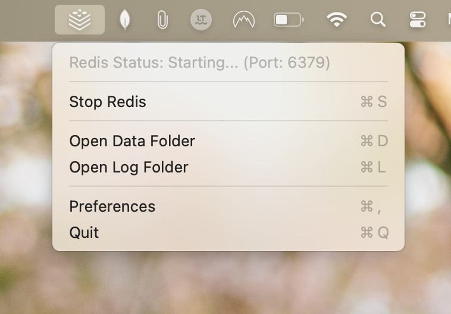
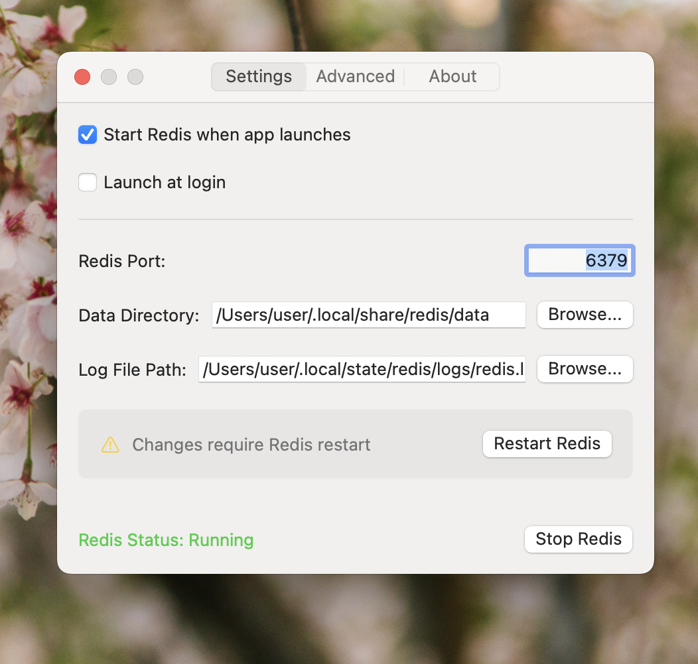
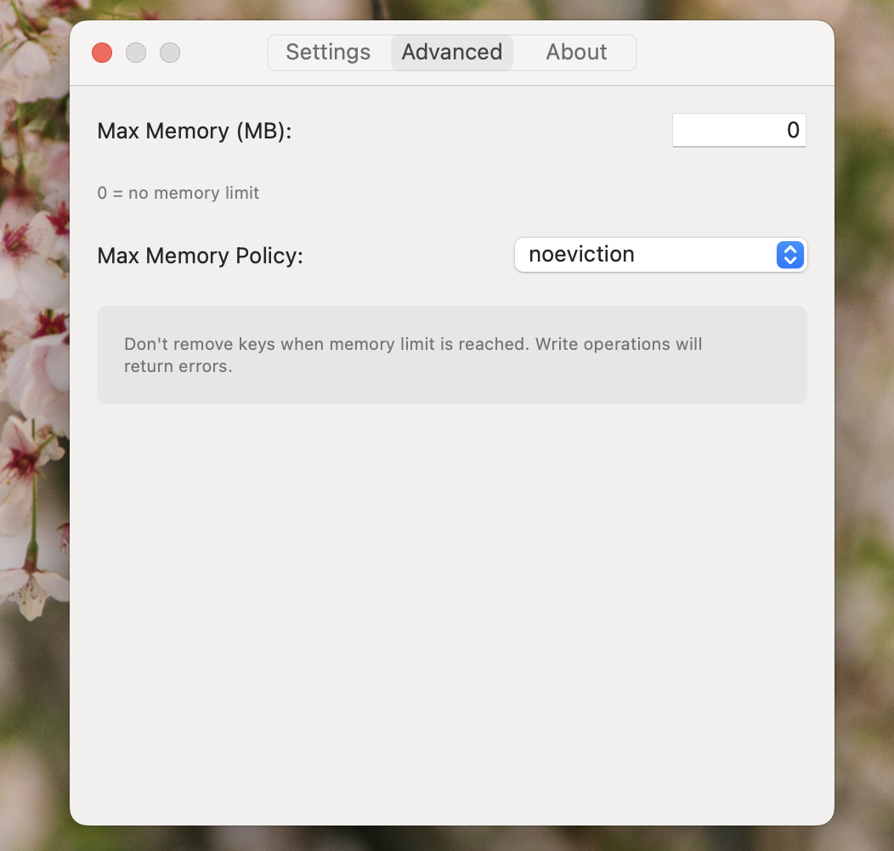

# RedisMenu



一款便捷的 macOS 菜单栏应用，让本地 Redis 实例的管理变得轻松简单。支持最新版本的 Redis（包括 Redis 8.x 及 7.x）。

## 概述

RedisMenu 常驻于 macOS 菜单栏，可快捷进行 Redis 实例的启动、停止与配置。专为在本地使用 Redis 的开发者设计，无需繁琐的终端命令即可快速掌控数据库状态。

## 功能特性

- **菜单栏快捷控制**：直接在顶部菜单栏一键启停 Redis 服务
- **状态直观指示**：实时显示当前运行状态与端口占用
- **支持最新版本 Redis**：支持最新 Redis 8.x（含 LFU 等现代淘汰策略），并自动适配本地已安装环境
- **丰富自定义配置**：支持配置 Redis 数据目录、日志路径、服务端口以及内存限制与淘汰策略
- **自定义可执行路径**：自动探测 `/Users/arona/tools/redis`、应用内置版本及系统 Homebrew 环境，并支持自定义选择 `redis-server`
- **自动启动选项**：支持在应用开启时自动拉起 Redis 实例
- **开机自启**：支持随 macOS 系统登录时自动启动 RedisMenu
- **轻量节能**：后台常驻内存极低，资源占用极小

## 界面预览




## 系统要求

- macOS 15.0 (Sequoia) 或更高版本
- 管理员权限（用于首次环境设置与开机项注册）

## 安装与构建

### 源码编译步骤：

1. 克隆代码仓库：

   ```bash
   git clone https://github.com/maquina-app/redis-menu.git
   cd redis-menu
   ```

2. 准备 Redis 核心与编译：

   若本地已有编译好的 Redis（如 `/Users/arona/tools/redis`），脚本将自动识别并打包；亦可自动拉取编译最新的 Redis 8 稳定版。

   ```bash
   ./build.sh
   ```

   构建脚本将执行：
   - 检查并准备 Redis 最新可执行文件
   - 编译并生成应用程序
   - 将应用打包至 `build/Release/RedisMenu.app`

3. 将生成的应用移动至“应用程序”（`/Applications`）文件夹即可使用。

## 构建依赖

- Xcode 16.0+ 或 Xcode 命令行工具（Command Line Tools）
- Swift 6.0+
- macOS 15.0 (Sequoia) 或更高版本

## 使用说明

1. 点击菜单栏的 Redis 图标查看当前状态及操作选项。
2. 点击 **“启动 Redis”** 或 **“停止 Redis”** 控制服务状态。
3. 点击 **“打开数据目录”** 或 **“打开日志目录”** 快速跳转对应文件夹。
4. 点击 **“偏好设置...”** 进行详细配置：
   - 数据存储目录（Data Directory）
   - 日志保存路径（Log File Path）
   - Redis 端口（默认：6379）
   - Redis 服务执行路径（支持自动检测与自定义）
   - 最大内存限制及淘汰策略（支持 `noeviction`、`allkeys-lru`、`allkeys-lfu` 等）
   - 应用启动时自动运行 Redis
   - 登录时开机自启

## 技术实现细节

RedisMenu 默认集成/打包了最新的 Redis 二进制程序，您无需额外配置环境。同时支持优先探测本地工具链中的最新版本（如 `/Users/arona/tools/redis`）。

默认数据与日志存储路径：

- Redis 数据目录：`~/.local/share/redis/data`
- Redis 日志文件：`~/.local/state/redis/logs/redis.log`

上述路径均可在偏好设置中自由更改。

## 常见问题排查

### Redis 无法启动
- 检查目标端口是否已被其他程序占用
- 确保对数据存储目录与日志路径拥有读写权限
- 偏好设置中可查看当前使用的 Redis 核心路径与日志文件排查详细报错

### 应用无法运行
- 请确认 macOS 系统版本为 15.0 (Sequoia) 或更高版本
- 尝试通过 `./build.sh` 重新进行本地构建

## 参与贡献

欢迎提交 Issue 与 Pull Request 共同改进项目！

1. Fork 本仓库
2. 创建特性分支 (`git checkout -b feature/amazing-feature`)
3. 提交修改 (`git commit -m 'feat: 增加新特性'`)
4. 推送至分支 (`git push origin feature/amazing-feature`)
5. 创建 Pull Request

## 原作者与致谢

- 原项目作者：Mario Alberto Chávez
- 分支与汉化维护：herta 分支

## 许可证

本项目基于 MIT 许可证开源，详情参阅 [LICENSE](LICENSE) 文件。

## 版权说明

© 2026 Maquina App. 保留所有权利。

## 免责声明

Redis 以及 Redis 徽标是 Redis Ltd. 的注册商标。本项目仅为第三方独立管理工具，与 Redis Ltd. 无官方关联。
